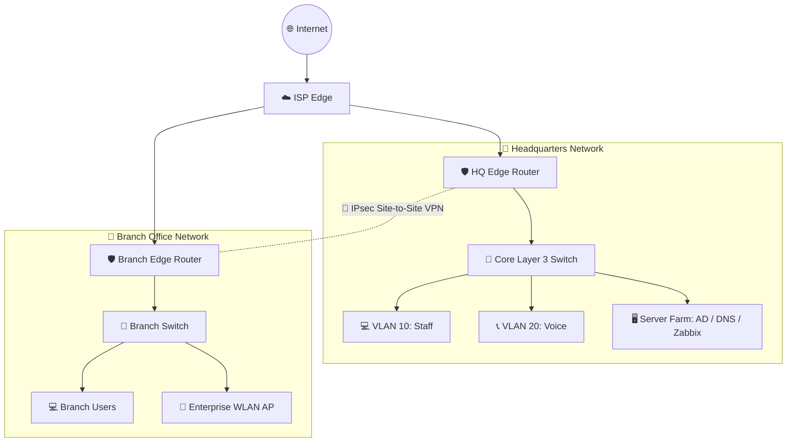

<div align="center">

<!-- Animated Typing Header -->
<a href="https://git.io/typing-svg">
  
</a>

### 🌐 Network Engineer • IT Infrastructure • Network Security
**Cambodia 🇰🇭 | Designing, Securing & Automating Enterprise Networks**

<br/>

<!-- Profile & Social Badges -->
<p align="center">
  <a href="https://YOUR-WEBSITE.com">
    
  </a>
  <a href="https://www.linkedin.com/in/YOUR-LINKEDIN">
    
  </a>
  <a href="mailto:YOUR-EMAIL">
    
  </a>
  
</p>

</div>

---

## 👨‍💻 `whoami`

```yaml
name: Somphos Thor
role: Network Engineer | IT Infrastructure Specialist
location: Cambodia 🇰🇭

core_competencies:
  networking: [Routing & Switching, OSPF, BGP, EIGRP, VLANs, STP/RSTP, EtherChannel]
  security: [Firewall Policies, Site-to-Site IPsec VPN, ACLs, Hardening, SSH]
  systems: [Windows Server (AD DS, DNS, DHCP), Linux (Ubuntu), Virtualization]
  monitoring_&_automation: [Zabbix, SNMP, Python, Bash, Git]

current_focus:
  - Advancing through Cisco CCNA / CCNP Enterprise tracks
  - Mastering MikroTik RouterOS & bandwidth engineering
  - Automating network provisioning & backups with Python
```

---

## 🛠️ Network Engineering Arsenal

<div align="center">

| Category | Technologies & Tools |
| :--- | :--- |
| **🌐 Vendors & Routing** |        |
| **🔐 Network Security** |      |
| **🖥️ Systems & Servers** |      |
| **🧪 Simulators & Tools** |      |
| **📊 Monitoring & Code** |      |

</div>

---

## 🏗️ Enterprise Lab Architecture

GitHub natively renders the Mermaid diagram below to showcase a standard Dual-Site Enterprise Topology:



---

## 🚀 Featured Network Projects

| Project | Tech Stack | Architecture & Scope |
| :--- | :--- | :--- |
| **🌐 Enterprise Campus Lab** | `Cisco IOS` `VLAN` `OSPF` `STP` | High-availability multi-VLAN campus network with L3 inter-VLAN routing and EtherChannel |
| **🔐 Site-to-Site IPsec VPN** | `Cisco` `IPsec` `IKEv2` `NAT` | Encrypted tunnel linking HQ and Branch networks over untrusted public WAN links |
| **🛡️ Edge Firewall & ACLs** | `Cisco IOS` `Extended ACLs` | Zone-based segmentation and granular packet filtering to isolate critical server subnets |
| **🌍 MikroTik ISP & Bandwidth** | `RouterOS` `WinBox` `Queues` | Dual-WAN failover, DHCP provisioning, firewall hardening, and QoS traffic shaping |
| **📊 Infrastructure Monitoring** | `Zabbix` `Ubuntu` `SNMPv3` | Real-time telemetry, interface bandwidth graphing, and automated outage alerting |
| **🐍 Network Config Automation** | `Python` `Netmiko` `Paramiko` | Automated CLI configuration backups and multi-vendor bulk VLAN deployment scripts |
| **🖥️ Windows Server Domain** | `Windows Server` `AD DS` `GPO` | Centralized domain controller setup with automated DHCP scopes, DNS, and Group Policy |
| **📡 Enterprise Wireless Lab** | `Cisco WLC` `LWAPP` `802.1Q` | Multi-SSID wireless deployment mapped to isolated guest and corporate VLANs |

---

## 🗺️ Certification & Learning Roadmap

```text
[✅ Networking Fundamentals] ➔ [⏳ Cisco CCNA] ➔ [🎯 CCNP Enterprise] ➔ [🔐 Network Security] ➔ [🤖 NetDevOps / Automation]
```

---

## 📊 GitHub Telemetry

<div align="center">
  
  
</div>

<div align="center">
  
</div>

---

<div align="center">

### 🌐 Connect • Configure • Secure • Automate
*"A good network is invisible — it simply works."*

</div>
